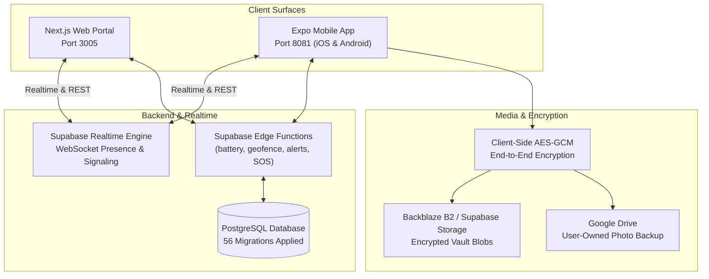

# A Little World With Us — Master Roadmap & Systematic Execution Plan

**Project Type:** Standalone Private Couple Space, Real-Time Presence & Media Vault  
**Platforms:** Next.js Web Portal (`http://localhost:3005`), React Native / Expo Mobile App (`8081`), Supabase Backend Functions  
**Status:** In Active Development & Local Verification  
**Language Specification:** English (Standard Technical Documentation)  
**Last Updated:** October 2026  

---

## 1. System Architecture & Topology

A Little World With Us is an end-to-end encrypted, private digital haven designed exclusively for two interconnected partners:
`Partner Onboarding & Link Code → Real-Time Presence & Chat → WebRTC Calling → Care Reminders & Safety Check-ins → Geofencing Alerts → Client-Side Encrypted Media Vault → Long-Term Timeline Archival`.

---

## 2. Completed Milestones & Operational Proofs

- [x] **Decoupled Standalone Infrastructure:** Assigned dedicated ports (Web: 3005, Mobile Expo: 8081).
- [x] **Database & Supabase Edge Functions:**
  - Complete database bootstrap with 56 migrations verified.
  - Supabase Edge Functions verified (`check-battery`, `check-geofence`, `checkin-notify`, `location-alerts`, `sos-resolved`, `reverse-geocode`).
- [x] **Web Frontend Platform (105 Pages, 74 Components):**
  - Private couple dashboard, interactive memory timeline, care reminders, real-time chat, shared calendar, wellness games, and couple settings.
- [x] **Mobile Client Suite (218 Files):**
  - Comprehensive React Native Expo application (`apps/mobile`): WebRTC calling integration (`call.tsx`), push notification handlers (`notifications.ts`), resilient Google Drive OAuth with auto-refresh, wellness boards, daily check-ins, memory maps, and secret vaults.

---

## 3. Comprehensive Remaining Tasks (Consolidated from Legacy Backlogs)

### Priority 1: WebRTC Production Signaling & Audio/Video Calling
- [ ] **STUN/TURN Production Relay:** Configure resilient COTURN / Xirsys credentials for peer connection traversal across symmetric NAT and cellular mobile networks.
- [ ] **Call Lifecycle State Machine:** Enforce deterministic connection states (`ringing`, `connecting`, `connected`, `reconnecting`, `ended`, `missed`) with audible ringtones and push wakeups.
- [ ] **Call Quality & Network Degradation Fallback:** Automatically downscale video resolution (720p → 480p → audio-only) during packet loss or low bandwidth.

### Priority 2: Battery-Optimized Geofencing & Safety Alerts
- [ ] **Adaptive GPS Duty-Cycling:** Implement distance-based background location polling to minimize phone battery drain while preserving arrival/departure accuracy.
- [ ] **Geofence Safe Zone Notifications:** Trigger automatic "Arrived Home" and "Departed Work" push notifications via `check-geofence` edge function.
- [ ] **SOS Emergency Dispatch:** Verify one-tap SOS trigger with instant SMS/push broadcast and live location beacon updates.

### Priority 3: End-to-End Encrypted Media Vault & Storage Sync
- [ ] **Client-Side AES-GCM Photo Encryption:** Encrypt images in-memory on device before uploading to Backblaze B2 or Supabase Storage.
- [ ] **Thumbnail Derivative Pipeline:** Generate low-resolution encrypted blurred thumbnails for fast timeline scrolling.
- [ ] **Automated Google Drive Sync:** Auto-sync high-resolution master memories to user's personal Google Drive folder with SHA-256 integrity verification.

### Priority 4: Couple Unlink & Data Retention Protocol
- [ ] **Couple Unlink Verification:** Test mutual and unilateral unlink flows, revoking shared access and triggering configurable data retention / export / purge workflows (`docs/features/couple-unlink.md`).
- [ ] **Data Export Archive:** Generate one-click ZIP export containing all chat logs, memory photos, and diary entries prior to account closure.

### Priority 5: Mobile EAS Build & Accessibility Sweep
- [ ] **Expo Application Services (EAS) Standalone Build:** Produce signed Android APK and iOS TestFlight builds.
- [ ] **WCAG Contrast & Screen-Reader Audit:** Ensure all pastel wellness color themes meet WCAG AA 4.5:1 text contrast ratios.

---

## 4. Next Systematic Steps

1. **Step 1:** Run Next.js web build (`npm run build`) and mobile typecheck to ensure zero syntax or dependency errors.
2. **Step 2:** Test real-time message and presence signaling between Web (port 3005) and Mobile (port 8081).
3. **Step 3:** Perform WebRTC STUN/TURN peer connection test in staging environment.
